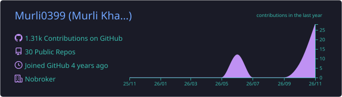
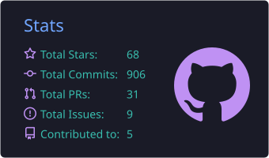
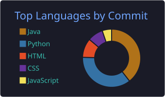

<!-- Banner -->
<p align="center">
  
</p>

<h1 align="center">Hey 👋, I'm Murli Khaire</h1>

<p align="center">
  <a href="https://github.com/Murli0399">
    
  </a>
</p>

<p align="center">
  <a href="https://www.linkedin.com/in/murli-khaire/"></a>
  <a href="https://Murli0399.github.io/"></a>
  <a href="mailto:murlikhaire28@gmail.com"></a>
  
</p>

---

## 🧑‍💻 About me

```java
public class MurliKhaire {

    String role       = "Software Development Engineer";
    String company    = "ConvoZen.ai (NoBroker's AI subsidiary)";
    String location   = "Bangalore, India";

    String[] building = {
        "AI pipelines with Azure OpenAI, Google Gemini and NeMo diarization",
        "Conversation intelligence processing 800K+ calls/day",
        "Distributed systems with Kafka, CQRS and Event Sourcing",
        "OAuth2 + PKCE authentication and three-tier RBAC"
    };

    String askMeAbout = "Java backend, Spring Boot, Kafka, LLM integrations";
}
```

## 🚀 What I work on

| | Area | Highlights |
|---|---|---|
| 🤖 | **AI / LLM systems** | Azure OpenAI and Gemini integrations, speaker diarization, call summarisation pipelines |
| ⚡ | **Event-driven backends** | Kafka pipelines, CQRS, event sourcing, retries and dead-letter topics |
| 🔐 | **Auth and multi-tenancy** | OAuth2 + PKCE, JWT, three-tier RBAC for a SaaS platform |
| ☸️ | **Infrastructure** | Docker, Kubernetes and GCP deployments |

## 📚 Interview prep repos

<p align="center"><i>Free, open-source question banks with answers, code and diagrams, ordered easy → hard. ⭐ them if they help you!</i></p>

<table align="center">
  <tr>
    <td align="center" width="33%">
      <a href="https://github.com/Murli0399/Java_Interview_Question"><b>☕ Java Interview Questions</b></a><br/><br/>
      369 questions: core Java, OOP, collections, multithreading, JVM, Java 8–21, DSA with LeetCode links, LLD<br/><br/>
      <a href="https://github.com/Murli0399/Java_Interview_Question/stargazers"></a>
      <a href="https://github.com/Murli0399/Java_Interview_Question/network/members"></a>
    </td>
    <td align="center" width="33%">
      <a href="https://github.com/Murli0399/SpringBoot_Interview_Questions"><b>🌱 Spring Boot Interview Questions</b></a><br/><br/>
      242 questions: IoC/DI, Boot 3/4, JPA and transactions, REST, Security, microservices with Kafka<br/><br/>
      <a href="https://github.com/Murli0399/SpringBoot_Interview_Questions/stargazers"></a>
      <a href="https://github.com/Murli0399/SpringBoot_Interview_Questions/network/members"></a>
    </td>
    <td align="center" width="33%">
      <a href="https://github.com/Murli0399/System_Design_Interview_Questions"><b>🏗️ System Design Interview Questions</b></a><br/><br/>
      217 questions + 14 HLD case studies with diagrams: caching, sharding, CAP, sagas, Uber, WhatsApp, payments<br/><br/>
      <a href="https://github.com/Murli0399/System_Design_Interview_Questions/stargazers"></a>
      <a href="https://github.com/Murli0399/System_Design_Interview_Questions/network/members"></a>
    </td>
  </tr>
</table>

## 🧠 Tech stack

<h4 align="center">Languages and frameworks</h4>
<p align="center">
  <a href="https://skillicons.dev">
    
  </a>
</p>

<h4 align="center">Databases, messaging and search</h4>
<p align="center">
  <a href="https://skillicons.dev">
    
  </a>
</p>

<h4 align="center">AI and LLM</h4>
<p align="center">
  
  
  
  
</p>

<h4 align="center">Cloud, DevOps and monitoring</h4>
<p align="center">
  <a href="https://skillicons.dev">
    
  </a>
</p>

<h4 align="center">Tools</h4>
<p align="center">
  <a href="https://skillicons.dev">
    
  </a>
</p>

## 📊 GitHub stats

<!-- These cards are generated daily by .github/workflows/profile-cards.yml in this repo -->
<p align="center">
  
</p>

<p align="center">
  
  
</p>

<p align="center">
  
</p>

<p align="center">
  <picture>
    <source media="(prefers-color-scheme: dark)" srcset="https://raw.githubusercontent.com/Murli0399/Murli0399/output/github-snake-dark.svg" />
    
  </picture>
</p>

---

<p align="center">
  <i>"Make it work, make it right, make it fast."</i> – Kent Beck
</p>
